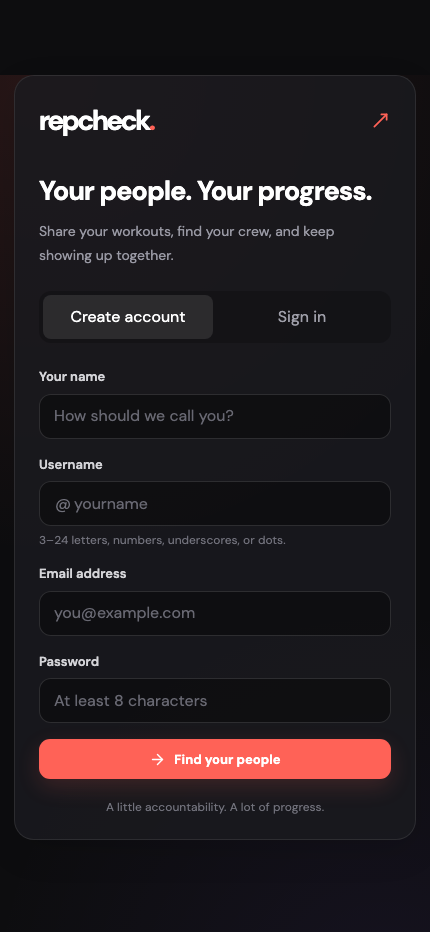
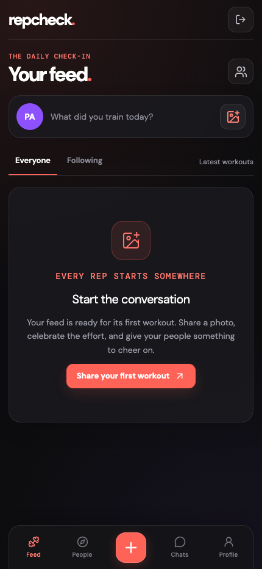
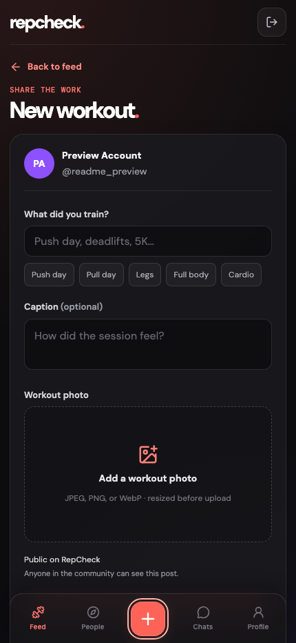
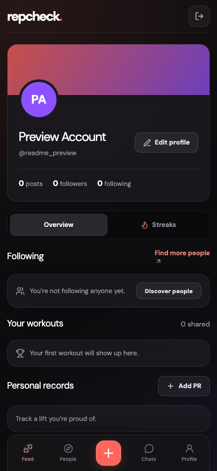

# RepCheck

### Your people. Your progress.

RepCheck is a fitness-focused social app built around showing up, sharing the work, and supporting your training community. Share workout photos, connect with other lifters, celebrate progress, and keep your crew close.

The mobile-first interface pairs a dark theme with coral accents and five simple destinations: **Feed**, **People**, **+**, **Chats**, and **Profile**. Workout streaks and personal records live in your profile, keeping the main navigation focused.

## Screenshots

These screenshots show the latest local development preview. The source currently on GitHub may reflect an earlier build. Screens were captured with an isolated preview account; no private account data or fabricated community activity is shown.

### Join the community

Create an account or sign in to start your fitness journey with RepCheck.

### Your workout feed

A place for workout check-ins and encouragement, with Everyone and Following views. A new community starts with an empty feed, ready for its first workout.

### Share the work

The central plus button opens a workout post. Add what you trained, an optional caption, and a workout photo.

### Track your progress

Your profile brings together shared workouts, connections, streaks, and personal records.

## Built for training together

- **Workout check-ins** — share a photo and what you trained.
- **Community connections** — discover lifters and follow their progress.
- **Encouragement** — support workouts through likes and comments.
- **Training groups** — keep conversations with your crew in private group chats.
- **Personal progress** — keep workout streaks and lifting records close at hand.

## Project status

RepCheck is an actively developed web MVP. The screenshots showcase the current local preview, not a published App Store release.
